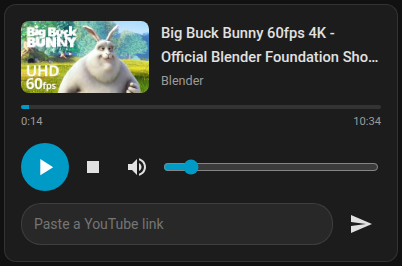

# YouTube DLNA card

A Home Assistant dashboard card that plays a pasted YouTube link on a DLNA renderer and
controls it, all in one card: thumbnail, title, channel, progress, play/pause, stop, volume
and the link field.



It's the front end of a paste-to-play pipeline: MeTube downloads the video into
`/media/youtube`, and HA plays the file on the renderer. Nothing on the panel talks to
YouTube. **[docs/PIPELINE.md](docs/PIPELINE.md)** has the full setup, the reasons for each
part, and the renderer quirks the card works around.

## Install

**HACS:** HACS > ⋮ > Custom repositories > add `https://github.com/ardyln/youtube-dlna-card`
as type **Dashboard**, then install **YouTube DLNA Card**.

**Manual:** copy `youtube-dlna-card.js` to `/config/www/`, then add it under Settings >
Dashboards > ⋮ > Resources as `/local/youtube-dlna-card.js`, type **JavaScript module**.

## Configuration

```yaml
type: custom:youtube-dlna-card
entity: media_player.kitchen_tablet_dlna
url_entity: input_text.youtube_url
now_playing_entity: input_text.youtube_now_playing
automation: automation.youtube_to_dlna
```

| Option | Required | What it does |
| --- | --- | --- |
| `entity` | yes | The DLNA renderer's `media_player`. |
| `url_entity` | yes | The `input_text` the automation triggers on. The card's link field writes to it. |
| `now_playing_entity` | no | `input_text` holding `<video id>\|<channel>`, filled by the automation. Shows the channel under the title. |
| `automation` | no | The paste-to-play automation. While it runs, the card shows "Loading video…". |

## How it gets the thumbnail

DLNA artwork doesn't survive the trip back from this kind of renderer, so the card doesn't use
it. It reads the 11-character video id from the playing file's name (`…/youtube/<id>.mp4`,
from MeTube's `%(id)s.%(ext)s` template) and loads `https://i.ytimg.com/vi/<id>/mqdefault.jpg`
directly.

## Notes

- **Play/pause** calls `media_play` or `media_pause` explicitly. The renderer advertises Pause
  only while playing and Play only while paused, which breaks `media_play_pause`. Buttons the
  renderer doesn't currently offer are greyed out.
- **The progress bar is display-only**, because the renderer doesn't support seeking. To start
  mid-video, paste a link with `t=`.
- **No dependencies:** plain custom element with shadow DOM and HA theme variables. It's
  small enough for a 1 GB panel.

## License

GPL-3.0-or-later. See [LICENSE](LICENSE).
